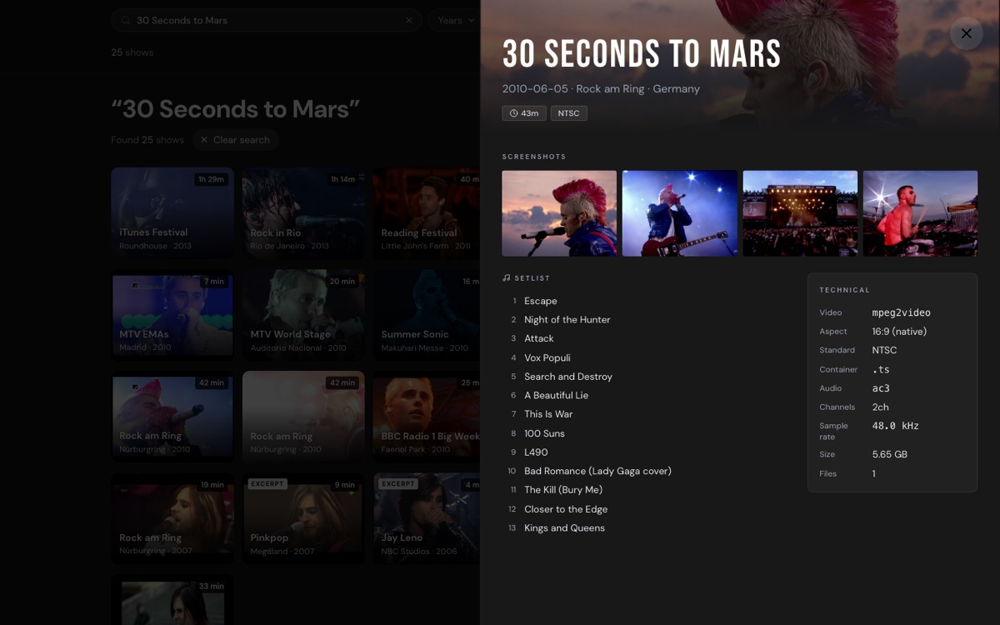
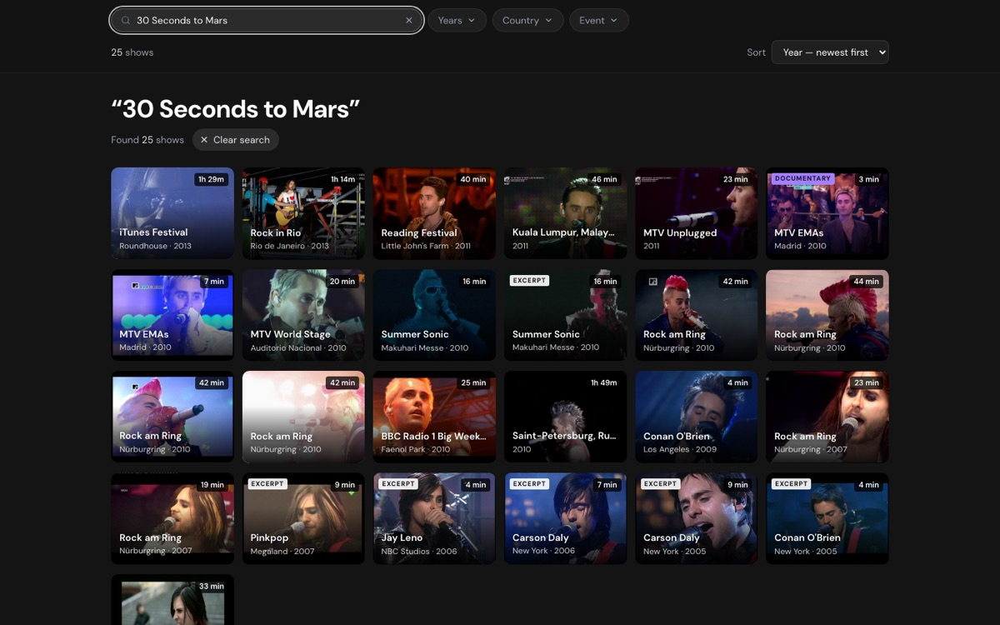
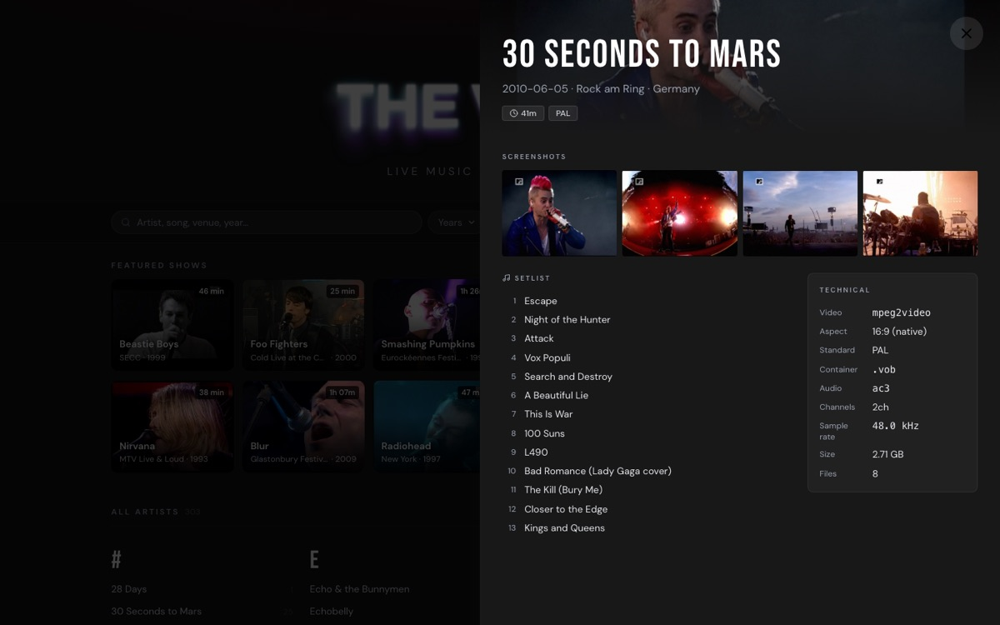
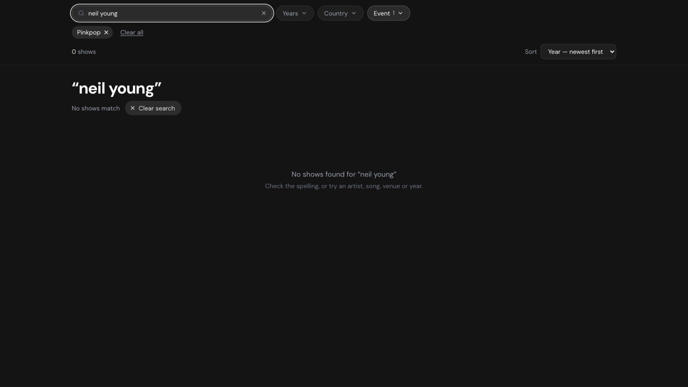

# The Vault — UX findings for archive traders

> **2026-10-16 · live site at `5ab10603`.** Method: an expert review against industry practice,
> plus a scripted walkthrough of eight trader profiles on the live site at their own screen sizes,
> 89 trader-style searches, and an analysis of `public/shows.json`.
> **No real traders have used the site yet**, so everything marked *observed* is what the site
> did, not how a person reacted. [04-test-plan.md](04-test-plan.md) is how to confirm it with
> people.
>
> Background: [persona](01-persona-archive-trader.md) · [participants](02-participants.md) ·
> [journeys and pain points](03-jobs-journeys-pain-points.md) · evidence screenshots in
> [`evidence/`](evidence/).

---

## Progress tracker

*Updated with every change that touches a finding. Last update: 2026-10-16 (batch E).*

### At a glance

> **Batches A–E are live** (pushed 2026-10-16, `8268bdbe`) and were re-checked on the live site
> the same day: [the traders' jobs, then and now](#the-traders-jobs-then-and-now).

**Done**

- [x] **Taper redaction** — lineage and generation shown without tapers' names, contacts or links
- [x] **A. The drawer's facts** — HD / SD quality label, codecs in traders' words, venue and city
  for every show, stills at full size, Escape keeps the search *(F1 part, F5, F9, F14)*
- [x] **B. Search** — dates in any format, artist initials (RATM, KOL…), other names for places and
  events, tech terms (hd, pal, pro shot…), empty results name the filter to blame *(F6, F8)*
- [x] **C. Links and sharing** — a link for every show, Back closes the show, Copy link / Share
  *(F3 part, F4)*
- [x] **D. Cards and copies** — date and quality on every card, "N copies" badge, a show's copies
  compared side by side in the drawer, one format for lengths *(F2, F17)*
- [x] **E. Readability** — every text passes the contrast minimum; nothing smaller than 12px but
  the card badges; holds at 200% zoom *(F13)*

**Still to do, in this order** *(re-scored 2026-10-16; the working is in [Fix these first](#fix-these-first--and-why-in-this-order))*

- [ ] **Now, alongside the rest: real traders.** A–E are live, so this is the moment the report
  set for it. Send the link with three tasks from [04-test-plan.md](04-test-plan.md) to two or
  three traders you already email. Everything still to do is predicted, not seen; their answers
  re-score it
- [ ] **1. Year-only dates read as the year in the drawer too** — the card says "2000", the drawer
  still says "2000-01-01" (seen on the live site). Minutes *(F7, part)*
- [ ] **2. Source on the blank records** — 329 records (27%) don't say Pro-shot or Audience; 126
  have a clue in their own notes or event (TV shows, broadcasters). A review page for those first,
  then the rest by their stills *(data)*
- [ ] **3. F. More filters** — quality (HD / SD / low-res), PAL / NTSC, length, has setlist, and
  source once step 2 is done *(F12)*
- [ ] **4. F. List view and CSV download** — the last thing between J3 and a pass *(F10)*
- [ ] **5. G. What's new** — the one job still failing (J7). **Needs your call first:** what
  counts as new? Git history can't tell — 244 records first appear in October, most of them
  splits and re-filings, not new recordings *(F11)*
- [ ] **6. H. Polish** — the searched song highlighted in the setlist, and setlist clean-up *(F15)*;
  the phone header shrinks on scroll *(F18)*; one line saying what the site is *(F16)*;
  `songs:` as well as `song:`
- [ ] **7. A page per show**, so a link pasted into WhatsApp or a forum previews that show, not
  the site *(F3)*
- [ ] **8. Date precision** ("2001, exact date unknown") and the 432 missing setlists, in their
  own reviews *(F7, data)*
- [ ] **9. Drive scan** — frame rate, bitrate, chapters, the show's own size *(needs Live Music
  mounted)*

### In detail

✅ done · 🟡 partly done · ⬜ to do · 📅 planned (needs the drive mounted)

| # | Finding | Status | Done so far | Still to do |
|---|---|---|---|---|
| [F1](#f1--which-copy-is-better-cant-be-answered) | Which copy is better | 🟡 | Generation and Lineage in the drawer (`1cffc551`), cleaned of tapers first (`0b538a57`). Batch A: quality badge (HD 1080 / HD 720 / SD 576 / SD 480 / Low-res), Resolution row, PAL/NTSC on SD only, codecs and containers in traders' words, size and file count as one "Folder" row | Source on the 329 blank records; frame rate, bitrate, chapters (drive scan) |
| [F2](#f2--recordings-of-the-same-show-arent-grouped-and-their-cards-are-identical) | Copies of one show not grouped | ✅ | Batch D: cards carry a quiet spec line, the full date and the quality (`2010-06-05 · HD 1080`), and an "N copies" badge when the show is held more than once (131 shows, 311 records); the drawer lists "N recordings of this show", longest first, with quality, length, source, codecs, container, audio, PAL/NTSC, size and song count, one click to each | — |
| [F3](#f3--nothing-can-be-linked-and-back-leaves-the-site) | No show links; Back leaves the site | 🟡 | Batch C: every show has a link (`?show=`); Back and the phone's back gesture close the show, Forward reopens it; a pasted link opens the show; the tab names it; page description and preview image for pasted links; an analytics seam for show views | A page per show, so a pasted show link previews that show (needs a build step) |
| [F4](#f4--pointing-at-one-exact-recording-is-hard) | Pointing at one exact recording | ✅ | Batch C: a Share pill (share sheet on phones, "Copy link" elsewhere): the link alone as plain text (pastes into an address bar or chat), and as rich text `Artist · date · event · quality · length` linked to the show (pastes into an email by name) | — |
| [F5](#f5--escape-erases-the-search-behind-an-open-show) | Escape erases the search | ✅ | Batch A: Escape closes only the show; the results stay, so the next copy is one click away | — |
| [F6](#f6--search-doesnt-match-how-traders-type) | Search misses how traders type | ✅ | Batch B: dates in every common format (and two-digit years); artist initials (RATM, FNM, KOL, 30STM…), no wrong "Did you mean"; countries, cities and events by other names (uk, brasil, koln, titp…); tech terms (hd, 1080, pal, pro shot, lpcm…); several field filters at once, quoted values; search tips in the empty state; 43 new search tests | Tips appear when a search finds nothing, not under the field |
| [F7](#f7--placeholder-dates-look-like-real-dates) | Placeholder dates look real | 🟡 | Batch D: cards show a year-only date (`YYYY-01-01`) as the year | The drawer still shows it in full (next quick fix); a `DatePrecision` field and backfill |
| [F8](#f8--empty-results-blame-spelling-when-a-filter-is-the-cause) | Empty results blame spelling | ✅ | Batch B: names the filters that hide the results and offers "Show N without the filter" | — |
| [F9](#f9--the-drawer-hides-venue-and-city-for-festival-and-tv-shows) | Venue and city hidden | ✅ | Batch A: `Date · Event · Venue · City, Country` under the name for every show | — |
| [F10](#f10--no-dense-list-export-or-useful-sort-for-reconciling-a-trading-list) | No list view or export | ⬜ | | Grid / List toggle, CSV download, more sorts, print |
| [F11](#f11--returning-traders-cant-see-whats-new) | No "what's new" | ⬜ | | `AddedOn` field, "Recently added" row, sort, RSS |
| [F12](#f12--filters-dont-cover-what-traders-decide-by) | Filters miss trader dimensions | ⬜ | "More filters" control agreed (2026-10-16) | Source, quality, standard, length, has setlist |
| [F13](#f13--too-faint-and-too-small-for-eyes-aged-4060) | Too faint, too small | ✅ | Batch E: every text passes 4.5:1, measured on the rendered page in 12 views (A–Z counts 1.7 → 5.3:1, heading counts 2.3/3.8 → 5.3:1, "No setlist yet" 3.8 → 6.8:1); nothing under 12px but the cards' badges (9.5 → 11px); the drawer's section labels 10 → 12px; Notes 12 → 13px; tab bar and year axis 10 → 12px; layout holds at 150% and 200% zoom | Text over the stills (cards, drawer header) is protected by the gradients but can't be measured automatically |
| [F14](#f14--stills-cant-be-inspected-closely) | Stills can't be inspected | ✅ | Batch A: "Open full size" in the screenshot viewer (the original, at 100%, in a new tab) | — |
| [F15](#f15--setlists-non-songs-counted-as-songs-the-searched-song-isnt-highlighted) | Setlist quality | 🟡 | One credit line removed from a Setlist (`0b538a57`) | 32 non-song entries; encore as a divider; highlight the searched song |
| [F16](#f16--a-first-visit-doesnt-say-what-this-is) | First visit doesn't say what this is | ⬜ | Lower priority: your email introduces the site | One plain line under the tagline |
| [F17](#low) | Truncation and formats | ✅ | Batch D: one length format everywhere (`1h 05m`, `42 min`); "Pro-shot"; "Undated" in the drawer as on cards; a card's full name, place and specs on hover | — |
| [F18](#low) | Phone header height | ⬜ | | Hide the count/sort row while scrolling down |
| — | [Taper redaction](#publishing-lineage-and-generation-without-exposing-tapers) | ✅ | Names, contacts and links captured to `private/`, then removed from `shows.json`; pipeline archives out of git; the site stops publishing folder names; health-check guard (`e2d03953`, `0b538a57`) | Old text stays in git history (accepted) |
| — | [Drive scan](#planned-a-drive-scan-for-the-missing-specs) | 📅 | Plan agreed (2026-10-16) | Frame rate, bitrate, menus and chapters, show size: with Live Music mounted. Broadcaster can start now |
| — | [Data quality](#data-quality--the-metadata-is-the-product) | ⬜ | | Source on 329 records, 432 setlists, venue and city, date precision |

### The traders' jobs, then and now

The review's walkthrough tasks, run again on the live site after batches A–E went out
(2026-10-16). Still a scripted run, not real traders.

| Job | At the review | Now | Still missing |
|---|---|---|---|
| J1 Do you have it? | 🟡 Partial | 🟢 **Pass** | The drawer shows a year-only date as a full date |
| J2 Is yours better? | 🔴 Fail | 🟢 **Pass** | Source blank on 27% of records; no broadcaster; frame rate and bitrate (drive scan) |
| J3 Artist audit | 🟡 Partial | 🟡 Partial | List view, CSV download, more sorts |
| J4 Song hunt | 🟢 Pass | 🟢 Pass | The song isn't highlighted in the setlist; `songs:` returns nothing |
| J5 Event dig | 🟡 Partial | 🟢 **Pass** | Filters by source, quality, length; small events (Fuji Rock) only by search |
| J6 Share and request | 🔴 Fail | 🟢 **Pass** | A pasted link previews the site, not the show |
| J7 What's new | 🔴 Fail | 🔴 Fail | Everything: nothing marks what's new |
| J8 Evidence check | 🟡 Partial | 🟢 **Pass** | Frame rate and bitrate (drive scan) |

**At the review: 1 pass, 4 partial, 3 fail. Now: 6 pass, 1 partial, 1 fail.** Both jobs traders
come for, J1 and J2, now pass.

<b>Each job, step by step: done and not done</b>

**J1 — Do you have it?**
- [x] Dates in any format: `1996-05-24`, `24.05.1996`, `May 24, 1996` each find the show
- [x] Artist initials: `RATM` finds Rage Against the Machine's 19 shows, not Rammstein
- [x] Places in other languages: `brasil` 16 shows, `köln` 24, `uk` 291
- [x] Two-digit years: `rock am ring 97` finds the show
- [x] The full date on every card (`1996-05-24 · SD 480`), so two shows in one year differ
- [x] Venue and city on every show: `2007-05-28 · Pinkpop · Megaland · Landgraaf, Netherlands`
- [ ] A year-only date reads as the year on the card, but as `2000-01-01` in the drawer

**J2 — Is yours better than mine?**
- [x] Copies of a show listed together in the drawer, side by side: "4 recordings of this show"
  (quality, length, source, codecs, size, songs), one click to each
- [x] "N copies" on the cards, so look-alike cards say why
- [x] HD or SD and the resolution on every copy (`HD 1080`, `SD 576`)
- [x] Lineage and generation shown, without tapers' names
- [x] Escape closes the show and keeps the results
- [x] Size labelled as the folder's, with its file count
- [ ] Source (Pro-shot, Audience) blank on 329 records
- [ ] No broadcaster field (BBC, MTV, Rockpalast…)
- [ ] Frame rate, bitrate, the show's own size (drive scan)

**J3 — What do you have that I don't?**
- [x] The A–Z show counts readable (1.7 → 5.3:1)
- [x] Date and quality on every card
- [ ] A dense list view to scan a run of shows
- [ ] CSV download to reconcile with a spreadsheet
- [ ] Sort by length, size or quality (today: year and artist)
- [ ] A printable list

**J4 — Where was this song played?**
- [x] `creep` finds 37 recordings, grouped as songs (already worked)
- [x] Field searches combine: `artist:pearl song:alive` finds 11
- [ ] The searched song highlighted in the setlist
- [ ] `songs:creep` returns nothing (only `song:` works)
- [ ] Search tips under the field (today only when nothing is found)

**J5 — Show me the series**
- [x] An empty result names the filter to blame and offers "Show 1 without the filter"
- [x] Year range, decades, oldest-first sort (already worked)
- [ ] Filters for source, quality, PAL / NTSC, length, has setlist
- [ ] Small events (Fuji Rock, Hurricane) in the Event filter

**J6 — Can I get it?**
- [x] Every show has its own link (`?show=…`)
- [x] Copy link (Share on phones): the link alone, or the show's name linked in an email
- [x] Back closes the show and stays on the site
- [x] A description and picture when the site's link is pasted
- [ ] A link to one show previews that show (needs a page per show)

**J7 — What's new?**
- [ ] A date each record was added
- [ ] A "Recently added" row and sort

**J8 — Evidence check**
- [x] Stills open at full size, in a new tab
- [x] The NFO text in full, larger (13px)
- [x] Lineage, resolution and codecs beside the stills
- [ ] Frame rate and bitrate (drive scan)

## Bottom line

The Vault is **fast, handsome and better at song search than most trading lists**. The stills are
real frames with the channel logos intact, which is exactly the evidence traders use.

But traders come with three questions: **do you have it, is it better than mine, and how do I get
it?** The site answers the first only if they type the way it expects. It can't answer the second,
because the fields that rank one recording against another are hidden, missing or mislabelled. The
third is answered by your email, but a trader replying to it still has to name the exact recording,
and today there's no link to give. In the walkthrough, the decisive comparison (which of four
copies of one show is the HD one) couldn't be made from anything on screen.

### Predicted task success (from the walkthrough)

| Journey | Result | The blocker |
|---|---|---|
| J1 Do you have it? | 🟡 Partial | Dates and abbreviations don't search |
| J2 Is yours better? | 🔴 Fail | No resolution; versions not grouped; Escape wipes the results |
| J3 Artist audit | 🟡 Partial | Year-only cards; no list view or export |
| J4 Song hunt | 🟢 Pass | (Song not highlighted in the setlist) |
| J5 Event dig | 🟡 Partial | Empty results blame spelling when a filter is the cause |
| J6 Share and request | 🔴 Fail | No per-show link; Back leaves the site |
| J7 What's new | 🔴 Fail | Nothing marks what's new |
| J8 Evidence check | 🟡 Partial | Stills can't be viewed at native size |

---

## Fix these first — and why in this order

The order comes from a score, so you can see the working and argue with any number. Each item gets
four ratings:

| Rating | What it measures | Scale |
|---|---|---|
| **Impact** | How badly the problem hurts a trader's job | 3 = a core job fails without the fix (J1, J2, J6) · 2 = leads to a wrong conclusion or a big detour · 1 = friction or polish |
| **Reach** | How often traders meet it | 3 = every visit, or most of the 1,213 shows · 2 = a common task, or hundreds of shows · 1 = an edge case, or dozens |
| **Confidence** | How sure we are it matters | 1.0 = seen in the walkthrough or measured in the data · 0.8 = predicted from the persona, not yet seen · 0.5 = a guess |
| **Effort** | How long it takes | 1 = under half a day · 2 = one to three days · 4 = a week or more, or data and pipeline work |

**Score = Impact × Reach × Confidence ÷ Effort.** It is a version of the RICE method product teams
use. The highest score goes first. Where two items touch the same code they are done together
(next table), and an item that depends on another waits for it.

| Rank | Fix | Finding | Impact | Reach | Conf. | Effort | **Score** | Why | Status |
|---|---|---|---|---|---|---|---|---|---|
| 1 | Resolution and an HD / SD / low-res label; trader names for codecs | [F1](#f1--which-copy-is-better-cant-be-answered) | 3 | 3 | 1.0 | 1 | **9.0** | Decides "which copy is better"; the data is on all 1,213 shows; 124 HD records are never called HD | ✅ batch A |
| 2 | Search by date, in every format | [F6](#f6--search-doesnt-match-how-traders-type) | 3 | 3 | 1.0 | 1 | **9.0** | A date is the trader's first search; every format returns nothing today | ✅ batch B |
| 3 | Venue and city always in the drawer | [F9](#f9--the-drawer-hides-venue-and-city-for-festival-and-tv-shows) | 2 | 3 | 1.0 | 1 | **6.0** | Identity of the show; hidden on 699 shows (venue) and 843 (city) | ✅ batch A |
| 4 | A link for every show; Back closes the show; link previews | [F3](#f3--nothing-can-be-linked-and-back-leaves-the-site) | 3 | 3 | 1.0 | 2 | **4.5** | Sharing fails, and Back leaves the site on every phone; also unlocks #7 and analytics, which you asked for | ✅ batch C |
| 5 | Escape keeps the search | [F5](#f5--escape-erases-the-search-behind-an-open-show) | 2 | 2 | 1.0 | 1 | **4.0** | A real bug, but × works and only keyboard users hit it; one line, so it rides along with batch A | ✅ batch A |
| 6 | Artist abbreviations (RATM, FNM…); no wrong "Did you mean" | [F6](#f6--search-doesnt-match-how-traders-type) | 2 | 2 | 1.0 | 1 | **4.0** | The full name works, so it's a detour, not a block | ✅ batch B |
| 7 | Share button with a one-line reference | [F4](#f4--pointing-at-one-exact-recording-is-hard) | 2 | 2 | 0.8 | 1 | **3.2** | Waits for #4 | ✅ batch C |
| 8 | Full date and a quiet spec line on cards (agreed) | [F2](#f2--recordings-of-the-same-show-arent-grouped-and-their-cards-are-identical) | 2 | 3 | 1.0 | 2 | **3.0** | 375 look-alike cards; a card change needs performance runs | ✅ batch D |
| 9 | "Other recordings of this show" table | [F2](#f2--recordings-of-the-same-show-arent-grouped-and-their-cards-are-identical) | 3 | 2 | 1.0 | 2 | **3.0** | The heart of J2, but only 118 shows (288 records) have several copies | ✅ batch D |
| 10 | Contrast and text sizes | [F13](#f13--too-faint-and-too-small-for-eyes-aged-4060) | 1 | 3 | 1.0 | 1 | **3.0** | Every visit, but it slows people rather than stopping them | ✅ batch E |
| 11 | Empty results name the active filters | [F8](#f8--empty-results-blame-spelling-when-a-filter-is-the-cause) | 2 | 1 | 1.0 | 1 | **2.0** | A wrong conclusion, but only with a filter and a search together | ✅ batch B |
| 12 | View a still at full size | [F14](#f14--stills-cant-be-inspected-closely) | 1 | 2 | 1.0 | 1 | **2.0** | Helps judge an encode; the stills already show logos | ✅ batch A |
| 13 | One format for durations and labels; tooltips on cut-off text | [F17](#low) | 1 | 2 | 1.0 | 1 | **2.0** | Polish | ✅ batch D |
| 14 | Country, city and event synonyms; tech terms; search tips | [F6](#f6--search-doesnt-match-how-traders-type) | 2 | 2 | 1.0 | 2 | **2.0** | Fewer misses, more work than dates | ✅ batch B |
| 15 | List view and CSV download | [F10](#f10--no-dense-list-export-or-useful-sort-for-reconciling-a-trading-list) | 2 | 2 | 0.8 | 2 | **1.6** | Predicted from how traders keep lists; not yet seen | ⬜ |
| 16 | "Recently added" | [F11](#f11--returning-traders-cant-see-whats-new) | 2 | 2 | 0.8 | 2 | **1.6** | Returning visitors; predicted. Needs your call on what counts as new: git history can't tell (244 records first appear in October, mostly splits and re-filings) | ⬜ |
| 17 | "More filters" (agreed) | [F12](#f12--filters-dont-cover-what-traders-decide-by) | 2 | 2 | 0.8 | 2 | **1.6** | Predicted; search covers part of it today. A source filter waits for #20: with 27% blank it would hide shows | ⬜ |
| 18 | Drive scan: frame rate, bitrate, chapters, show size | [Plan](#planned-a-drive-scan-for-the-missing-specs) | 2 | 3 | 1.0 | 4 | **1.5** | Needs Live Music mounted | 📅 |
| 19 | Date precision ("2001, exact date unknown") | [F7](#f7--placeholder-dates-look-like-real-dates) | 2 | 2 | 1.0 | 4 | **1.0** | 257 records; mostly data work | ⬜ |
| 20 | Fill in Source on 329 records | [Data](#data-quality--the-metadata-is-the-product) | 2 | 2 | 1.0 | 2 | **2.0** | Re-scored 2026-10-16: 126 of the 329 have a clue in their own notes or event, so a review page settles them quickly (Effort 4 → 2); the other ~200 need their stills looked at | ⬜ |
| 21 | Setlists: 32 non-song entries; encore as a divider; highlight the searched song | [F15](#f15--setlists-non-songs-counted-as-songs-the-searched-song-isnt-highlighted) | 1 | 1 | 1.0 | 1 | **1.0** | Small | 🟡 |
| 22 | Phone header shrinks while scrolling | [F18](#low) | 1 | 1 | 0.8 | 1 | **0.8** | Polish | ⬜ |
| 23 | One line saying what the site is | [F16](#f16--a-first-visit-doesnt-say-what-this-is) | 1 | 1 | 0.5 | 1 | **0.5** | Your email already introduces the site | ⬜ |
| 24 | Year-only dates read as the year in the drawer too, as on the cards | [F7](#f7--placeholder-dates-look-like-real-dates) | 2 | 2 | 1.0 | 1 | **4.0** | Added 2026-10-16: seen on the live site (card "2000", drawer "2000-01-01"); minutes of work | ⬜ |
| — | Lineage and Generation, after the taper redaction | [Redaction](#publishing-lineage-and-generation-without-exposing-tapers) | | | | | | | ✅ `0b538a57`, `1cffc551` |

The 432 missing setlists continue separately, in their own review (`tools/missing-setlists`).

### The order of work

Items that touch the same code ship together, so each area is opened, tested and measured once.
A batch's place comes from its best score.

| Batch | Ranks | What | Why together |
|---|---|---|---|
| **A. The drawer's facts** ✅ | 1, 3, 12, plus 5 | Resolution and HD/SD label with codec names; venue and city; full-size still; the Escape fix | All in the show drawer; one performance run covers them |
| **B. Search** ✅ | 2, 6, 11, then 14 | Dates; abbreviations; empty results; then synonyms and tips | All in the search index and results page, with one set of search tests |
| **C. Links and sharing** ✅ | 4, 7 | Show links, Back, previews; then Share | Share needs the links |
| **D. Cards and copies** ✅ | 8, 9, 13 | Full date and spec line; other recordings; formats | Cards are the most performance-sensitive part of the site |
| **E. Readability** ✅ | 10 | Contrast and sizes | Touches every screen; best after D settles the cards |
| Quick fix | 24 | Year-only dates read as the year in the drawer | Highest score left; minutes |
| Source | 20 | Source on the blank records: the 126 with a clue first, on a review page | Scores above F once re-estimated, and F's source filter needs it |
| **F. Narrow and list** | 17, 15 | "More filters" (quality, standard, length, has setlist, then source); then a Grid / List toggle and CSV download | Both live in the results header and share the same facets; a list needs the trader columns the filters add |
| **G. What's new** | 16 | An added-on date per record, a "Recently added" row and sort | Ties with F; waits for your call on what counts as new |
| **H. Polish** | 21, 22, 23 | Setlist non-songs and the encore as a divider, the searched song highlighted; phone header shrinks on scroll; one line saying what the site is | Small, independent |
| Page per show | F3 leftover | A link to one show previews that show in chats and forums | Needs a build step; matters once traders share links among themselves |
| Data | 19 | Date precision; the missing setlists | Your review pages, record by record |
| Drive | 18 | Frame rate, bitrate, chapters, show size | When Live Music is mounted |

### What would change the order

- **Real traders.** The sessions in [04-test-plan.md](04-test-plan.md) replace the Reach and
  Confidence guesses with evidence; an item seen to stop several people jumps up.
- **Your priorities.** If analytics matters sooner, links (#4) move up; if sharing in the email
  thread is the bottleneck, so does Share (#7). Tell me and I'll re-score.
- **Effort surprises.** A fix that turns out bigger than estimated is re-scored before it starts.

---

## What works — keep it

- **Speed.** About 1 MB and 21 requests to a usable phone page; the drawer opens in about 30 ms.
  Traders open dozens of shows a session, so this matters.
- **Stills as evidence.** Uncropped frames with logos (Channel V, Multishow, VH2, MTV) let a
  trader identify the broadcast at a glance ([e07](evidence/e07-phone-drawer-setlist-junk.jpg),
  [e09](evidence/e09-placeholder-date-2001-01-01.jpg), [e11](evidence/e11-viewer-capped-at-drawer-width.jpg)).
- **Song search.** "creep" returns 37 recordings across Stone Temple Pilots, Radiohead and a Korn
  cover, grouped under Songs with the song named on each card
  ([e12](evidence/e12-song-search-creep.jpg)). Few trading resources do this.
- **Forgiving in places:** accents ignored (`nurburgring` → 54), "Did you mean" for typos, RHCP,
  STP and QOTSA aliases, `glasto`.
- **Notes verbatim.** The sidecar NFO is the document traders trust most; showing it untouched is
  right.
- **ISO dates** (`2010-06-05`) are unambiguous across Europe, the Americas and Japan.
- **Filters done properly:** counts per option, chips, Clear all, state in the URL, a year
  histogram, typed From/To.
- **Phone basics:** tab bar, 16px inputs (no iOS zoom), full-screen show sheet, readable filter
  lists ([e13](evidence/e13-phone-country-filter.jpg)).
- **Excerpt and "Part of…" links** model multi-artist broadcasts the way traders think about them.
- **Keyboard and screen-reader groundwork:** focus trap, focus return, real buttons, live result
  count.

---

## Findings

Severity: **Critical** = blocks a core trader job (J1, J2, J6) · **High** = leads to wrong
conclusions or big detours · **Medium** = slows people down; a workaround exists · **Low** = polish.

### Critical

#### F1 — "Which copy is better?" can't be answered

*J2, J8 · all participants, P1, P4 and P5 most*

**What we saw.** Thirty Seconds to Mars at Rock am Ring 2010 exists as four recordings. Two are
720×576 PAL DVDs; two are **1920×1080**. Nothing on screen says so. The drawer of one 1080 copy
reads `43m · NTSC · mpeg2video · .ts · 5.65 GB`, and the other reads `PAL · h264 · .mkv`. A trader
would have to infer HD from the container and file size. Only one of the four is marked "Proshot".

Across the collection:
- **Resolution is never shown**, although `Width` and `Height` exist on 100% of records. They're
  in `DROPPED` in `scripts/site-data.mjs:32`.
- **124 HD records are never called HD**; 85 of them display "NTSC", 36 "PAL". For HD, PAL/NTSC
  says nothing useful.
- **43 low-resolution records** (352 px wide or less, e.g. the Glastonbury 2003 masters at
  352×288) carry no warning. To a trader that is the first thing to know.
- **Source** (`RecordingType`) is blank on 329 records (27%).
- **Lineage** (247 records) and **Generation** (85) exist but are dropped from the site.
- **Size and Files describe the whole folder**, not the show: Aerosmith 2002-02-02 shows
  `4 min · 2.70 GB · 16 files`. A trader reads that as a broken bitrate.
- Codec names are ffprobe internals (`mpeg2video`, `pcm_dvd`, `ac3`, `.vob`) and the aspect
  carries the internal word "(native)".
- No broadcaster, bitrate, frame rate, DVD5/DVD9, or menus and chapters.

**Why it matters.** Ranking recordings *is* the trader's job (the "better" ladder in the
[persona](01-persona-archive-trader.md#what-makes-one-recording-better-typical-order)). Without
source, resolution and lineage the site is a list of titles, which is the thing traders already
have too many of.

**Best practice.** The Internet Archive's Live Music Archive and the Dime A Dozen info-file norms
make source, lineage and transferer first-class fields. Product pages present specs in the
buyer's vocabulary with units (Nielsen heuristic 2, *match between system and the real world*).
MediaInfo, the tool traders use, says "MPEG-2 Video, 720×576, 25 fps, AC-3 2.0, 448 kb/s".

**Fix.**
1. Add a **Resolution** row (`1920 × 1080`) and a badge **HD 1080 / HD 720 / SD 576 / SD 480 /
   Low-res 288**. Show the PAL/NTSC badge only for SD. Remove `Width` and `Height` from `DROPPED`.
   Cost: about 7 KB gzipped, together with lineage and generation.
2. Trader labels in `techRows` (`components/ShowDrawer.tsx:272`): MPEG-2, H.264/AVC, HEVC · Dolby
   Digital (AC-3), LPCM, MPEG audio (MP2), AAC · DVD-Video (VOB), MPEG-TS, MKV. Drop "(native)".
3. A **Source** block above Technical: Source (Pro-shot / Audience / Unknown) · Generation ·
   Lineage, published through the taper redaction (see
   [Publishing lineage and generation without exposing tapers](#publishing-lineage-and-generation-without-exposing-tapers)).
4. Label size honestly: "Folder size (may include other content)", or show it only when the
   folder holds this one show.
5. Data: backfill `RecordingType` on the 329 blanks. Later, scan frame rate, bitrate,
   menus/chapters and broadcaster into the pipeline.

**Effort.** 1–2: S. 3: S. 4: S. 5: L.

#### F2 — Recordings of the same show aren't grouped, and their cards are identical

*J2, J3 · P2, P5, P6*

**What we saw.** 118 shows have two or more recordings, and none link to each other. In an
artist view, **375 cards fall into 155 groups with identical captions**: four "Rock am Ring ·
Nürburgring · 2010" cards, three "Pinkpop · Megaland · 2000" (Pearl Jam), two "VH1 Storytellers ·
The Avalon · 2006" (both 44 min). Cards show the **year only**, so two shows in one year also look
alike.

**Why it matters.** The only way to compare is to open each card in turn and remember the specs.
That is the job a table should do.

**Best practice.** Discogs groups every pressing of an album under one *master release* with a
versions table (format, country, year, label), and every version has its own page. Shopping sites
show the decisive attribute on every list item and offer a compare view for products that are
chosen on specs (Baymard Institute research on product lists and comparison).

**Fix.**
1. In the drawer: **"Other recordings of this show (3)"**, matched on Artist + ShowDate (ignoring
   linked excerpts), as a small table: Length · Source · Resolution · Standard · Video · Audio ·
   Size · Songs. Each row opens that recording.
2. On cards in an artist view: the **full date** instead of the year, and a quiet spec line in the
   same type as the date: `2010-06-05 · HD 1080`. Plus a "3 recordings" marker where a show has
   several. (This brings back some of what was removed on 2026-10-15; see *Earlier decisions*
   below.)
3. Measure the card change with `npm run perf` (CLAUDE.md, *Front-end performance*).

**Effort.** M.

#### F3 — Nothing can be linked, and Back leaves the site

*J6, all · P6, P3, P8*

**What we saw.** With Foo Fighters at Big Day Out 2000 open, the address bar reads
`/?q=big%20day%20out`. Pasted into a new tab, it opens 35 search results, not the show
([e08](evidence/e08-shared-link-lands-on-search.jpg)). Pressing browser **Back** while a show is
open leaves the site entirely (opening a show adds no history entry; the URL is only ever
`replaceState`d). The page has no meta description and no Open Graph image, so links pasted into
WhatsApp, Discord or forums show no preview. `robots.txt` and `sitemap.xml` return 404, so Google
can index only the home page.

**Why it matters.** Traders work by sending links: "this one?" in a thread. A recording that
can't be linked can't be talked about. On Android and iOS the back gesture is how people close
things; leaving the site mid-session is the worst outcome.

**Best practice.** Every item that can be discussed gets a stable URL (setlist.fm, Discogs,
archive.org; NN/g on deep linking). An overlay that represents content should be in the browser
history so Back closes it.

**Fix.**
1. Opening a show `pushState`s `?show=<ShowID>` (beside the filter params in `src/lib/url.ts`);
   `popstate` closes it; loading a URL with `show=` opens it once the data is in. pushState doesn't
   touch layout, so the ~30 ms open time is safe; measure it anyway.
2. Site-level `<meta name="description">` and `og:image` in `index.html`.
3. Later: generate a static page per show at build (`dist/show/<id>/index.html`, as the
   thumbnails are generated) carrying that show's title, date and still in Open Graph tags, plus a
   `sitemap.xml`. GitHub Pages serves a folder's `index.html` without any SPA fallback, so it works
   on the current host. Searching "Pearl Jam Pinkpop 2000 video" would then find The Vault.

**Analytics.** A per-show URL also gives analytics something to count: which recordings get
opened, and from which search or filter. Filter changes already pass through one seam
(`commitFilterState` in `src/store/filters.ts`); opening a show would be the second.

**Effort.** 1–2: M. 3: L.

#### F4 — Pointing at one exact recording is hard

*J6 · P6, P3, all*

**Your answer (2026-10-16).** The site exists for trading. Traders arrive from your direct email,
so they already know whose collection it is and how to reach you. **No contact details on the
site.**

**What still matters.** A trader replying to your email, or telling a friend, has to name the
exact recording. With 118 shows in several copies and identical cards, "Rock am Ring 2010" isn't
enough, and there's no link to paste (F3).

**Fix.** A **Share** button in each show: the phone's share sheet on mobile, "Copy link" on
desktop. It copies the show's link (F3) with a one-line reference, e.g.
`30 Seconds to Mars · 2010-06-05 · Rock am Ring · HD 1080 · 43 min — <link>`, ready to paste into
the email thread.

**Effort.** S, once F3 exists.

### High

#### F5 — Escape erases the search behind an open show

*J2, J3 · P5 (any keyboard user)*

**What we saw.** Search "30 Seconds to Mars" → open a show → press **Escape**. The search clears,
the results behind are replaced by the home page, and the show **stays open**. A second Escape
closes it. Then the trader has to search again to reach copy 2. The × button behaves correctly.

**Cause.** Two window-level Escape listeners both fire: App's "Escape clears the search"
(`App.tsx:137–143`) doesn't know a show is open.

**Fix.** In App's handler, return early while a show is open (`if (selectedShow) return;`), or
skip any Escape the drawer has already handled. Add the case to the drawer checks.

**Effort.** S.

#### F6 — Search doesn't match how traders type

*J1, J4, J5 · P1, P3, P7, P8*

**What we saw** (full battery in [04 §9](04-test-plan.md#search-batteries-desktop-89-queries--the-ones-that-matter)):

| Traders type | Result |
|---|---|
| `1996-05-24`, `24.05.1996`, `24/05/1996`, `May 24 1996`, `1996-05` | **0 in every format**, even the form the drawer displays |
| `Rock am Ring 97`, `'97` | 0 |
| `RATM` / `FNM` / `30STM` / `KOL` | 0. **`RATM` suggests "Rammstein"** ([e02](evidence/e02-ratm-suggests-rammstein.jpg)) |
| `SP` | 5 unrelated results, not Smashing Pumpkins |
| `uk`, `deutschland`, `brasil`, `usa` | 0, 0, 2 (not 16), 4 (word matches, not 381 US shows) |
| `koln` | 0, suggests "**Korn**" (`cologne` finds 24) |
| `pal`, `ntsc`, `hd`, `1080i`, `sbd`, `dvd9` | 0 or stray song hits; `soundboard` suggests "**Soundgarden**" |
| `TITP`, `R&L` | 0 |
| `artist:pearl year:2000`, `venue:"brixton academy"` | 0 (each prefix works alone; combined or quoted they don't) |

Field prefixes (`artist:`, `venue:`, `event:`, `year:`, `country:`, `type:`, `song:`, `note:`)
exist but appear nowhere on the site.

**Why it matters.** A date is the trader's primary key, and abbreviations are how they talk. A
wrong "Did you mean" is worse than none: it suggests the collection lacks what it has.

**Best practice.** Search should accept users' abbreviations, synonyms and formats, not just the
catalogue's spelling (Baymard Institute on-site search research). "Did you mean" should
outrank fuzzy guesses with exact alias matches.

**Fix.**
1. **Auto-generate initials** for every artist (RATM, FNM, 30STM, KOL, QOTSA, SOAD…) into
   `ARTIST_ALIASES` (`src/search/searchIndex.ts:175`, five hand-written entries today); drop
   collisions and keep hand-written overrides. An exact alias hit must suppress fuzzy "Did you
   mean".
2. **Index dates** in several forms: `1996-05-24`, `24.05.1996`, `24/05/1996`, `05/24/1996`,
   `1996-05`, `may 1996`, `96` / `'96`.
3. **Synonyms**: countries (uk/england/britain → United Kingdom; usa/us/america; brasil;
   deutschland; holland/nederland; españa…), cities (Köln, München, Nürnberg, Wien, Lisboa…),
   events (TITP, R&L, RaR, RiP, BDO, ACL), tech terms (pal, ntsc, hd, 1080, sd, aud, sbd, pro-shot).
4. Support **quoted phrases** and **several prefixes** at once.
5. A **"Search tips"** line under the field: `artist:` `song:` `venue:` `event:` `year:`
   `country:` `type:` `note:`.
6. Add every case above to `npm run check:search`.

**Effort.** M.

#### F7 — Placeholder dates look like real dates

*J1 · P3, P7*

**What we saw.** Foo Fighters at Rock in Rio shows **`2001-01-01`**
([e09](evidence/e09-placeholder-date-2001-01-01.jpg)). By the data convention, "year known only"
is stored as `YYYY-01-01` and "month known" as `YYYY-MM-01`, with no flag. Up to **257 records**
(104 and 153) may be showing invented precision; some first-of-month dates are real, but the site
can't tell which.

**Why it matters.** Traders know when shows happened. A wrong-looking date makes them distrust
the rest of the record.

**Fix.** Add `DatePrecision: "year" | "month"` (the health check and site read it) and display
"2001 · exact date unknown" or "May 2001". Backfill from `PrivateNotes` and the folder names, then
check the remainder by hand. Until then, at least render `YYYY-01-01` as the year alone.

**Effort.** M (mostly data).

#### F8 — Empty results blame spelling when a filter is the cause

*J5 · P7*

**What we saw.** With the Pinkpop filter on, typing "neil young" shows **"No shows found for
'neil young'. Check the spelling, or try an artist, song, venue or year."** The collection has a
Neil Young show; the filter hides it. A careful reader like P7 believes the page and leaves.

**Best practice.** A no-results page should name the filters in force and offer to remove them
(Baymard Institute's no-results research).

**Fix.** In `components/SearchResultsGrid.tsx:108–109`: when filters are active, count the query
alone. Say "No Neil Young shows at Pinkpop" and offer "**1 Neil Young show without this filter →**".
Reserve "check the spelling" for when the query alone finds nothing.

**Effort.** S.

#### F9 — The drawer hides venue and city for festival and TV shows

*J1, J2 · P1, P5, P7*

**What we saw.** The drawer's subtitle is `Date · Event · Country` whenever an event is set
(`components/ShowDrawer.tsx:495–503`). **699 records never show their venue, and 843 never show
their city.** Rock am Ring 1996 doesn't say Nürburgring; Bizarre Festival 1997 (Butzweilerhof,
Cologne) and Bizarre 2002 (Flughafen Niederrhein) can't be told apart by place.

**Fix.** Always show the place: `2010-06-05 · Rock am Ring` / `Nürburgring, Nürburg, Germany`, as a
second line or a "Where" row.

**Effort.** S.

#### F10 — No dense list, export or useful sort for reconciling a trading list

*J3 · P2, P5*

**What we saw.** Results are image cards only (2–6 per row). Sorts: year newest or oldest, artist
A–Z. Nothing can be copied or downloaded; printing gives the gallery.

**Why it matters.** Every trader keeps a spreadsheet. Reconciling 21 Pearl Jam recordings means
opening 21 drawers and typing.

**Best practice.** Collections chosen on specs offer a list view beside the grid (Baymard). Discogs
exports a collection as CSV; trading lists have been TXT, XLS or HTML tables for decades.

**Fix.** A **Grid / List** toggle (in the URL), with list rows: Date · Artist · Event · Venue ·
City · Country · Source · Length · Resolution · Standard · Size. A **"Download CSV"** of the
current results, generated in the browser. Sorts by length, size and date added. A print
stylesheet for the list.

**Effort.** M.

#### F11 — Returning traders can't see what's new

*J7 · P5, P2*

**What we saw.** The landing page shows 12 shuffled Featured picks and the A–Z list. No record
carries an "added" or "updated" date (`LastScannedAt` is a drive-scan date and isn't published).

**Fix.** An `AddedOn` field, backfilled from git history (the first commit of `public/shows.json`
that contains each ShowID) and set on every new record; a **"Recently added"** row above Featured;
a "Date added" sort; optionally an RSS/Atom feed built at deploy.

**Effort.** M.

### Medium

#### F12 — Filters don't cover what traders decide by

*J5, J2 · P1, P5*

Today: Years, Country (6+ shows), Event (6+ shows). Missing: **Source** (Pro-shot / Audience /
Unknown), **Quality** (HD / SD / Low-res), **Standard** (PAL / NTSC), **Length** (under 20 min /
20–60 / 60+, which separates TV spots from full sets: 393 records run under 20 minutes), **Has
setlist**, **Live / Documentary**. Events with fewer than 6 recordings (Fuji Rock, Hurricane…) are
reachable only by search. **Fix:** one "More filters" control to keep the bar to a single row, and
smaller events under "More events" rather than hidden. **Effort:** M.

#### F13 — Too faint and too small for eyes aged 40–60

*All · P2, P7, P4*

| Text | Measured | WCAG 2.2 AA |
|---|---|---|
| A–Z show counts (`text-white/17`, `ArtistDirectory.tsx:93`) | **≈1.7:1** at 12px | Fails 4.5:1 ([e10](evidence/e10-ipad-a-z-faint-counts.jpg)) |
| Secondary hints and counts in `gray-500` ("Check the spelling…", "in 37 shows") | ≈3.8:1 at 12–14px | Fails 4.5:1 |
| Labels and body in `gray-400` | ≈7:1 | Passes |
| Section labels (SETLIST, TECHNICAL…) | 10px uppercase | Readable only up close |
| Card badges (EXCERPT, DOCUMENTARY) | 9.5px | Too small |
| Notes (NFO text) | 12px monospace | Small for long reading |

**Fix:** counts and hints to `gray-400` or lighter; section labels 11–12px; badges 11px; Notes
13–14px. Re-check at 150% browser zoom. (The A–Z "Ghost" level was a deliberate choice on
2026-10-13; it still fails the 4.5:1 minimum for text that carries information.) **Effort:** S.

#### F14 — Stills can't be inspected closely

*J8 · P4, P1*

The viewer stays inside the drawer: on a 16" MacBook a 768×576 still is shown at 671×503 CSS
pixels, with no 1:1 view and no link to the original
([e11](evidence/e11-viewer-capped-at-drawer-width.jpg)). **Fix:** a "View full size" action that
opens the original JPEG, and the still's pixel size shown in the viewer. **Effort:** S.

#### F15 — Setlists: non-songs counted as songs; the searched song isn't highlighted

*J4 · P8, P6*

32 setlist entries are not songs ("Jam", "Interview (cuts in)") yet are numbered as songs
([e07](evidence/e07-phone-drawer-setlist-junk.jpg)); CLAUDE.md already says they belong in
`PrivateNotes`. "Encore break" is numbered like a song, which inflates the count. Arriving from a
song search, the matched song isn't marked in the setlist. **Fix:** clean the 32 entries; render
the encore as a divider; highlight the matched song (pass the search's song hits to the drawer).
Later: song timings and a completeness flag. **Effort:** S (+ data).

#### F16 — A first visit doesn't say what this is

*T0 · all*

The masthead is the wordmark and "Live music worth reliving". The collection's size appears only
as "All artists 303" far below the fold; whose collection it is and what can be done with it
appear nowhere. Lower priority now that your email introduces the site; still useful for anyone a
trader forwards the link to. **Fix:** one plain line under the tagline, e.g. "A private archive of 1,213 live
concert recordings, 1960s–2010s" **Effort:** S.

### Low

- **F17 — Truncation and inconsistent formats.** "Rage Against the Ma…", "Kuala Lumpur, Malay…"
  on six-column cards with no tooltip; durations "1h 05m" on cards but "1h 5m" in the drawer;
  "Proshot" where traders write "Pro-shot"; "Date Unknown" in the drawer but "Undated" on cards.
  Add `title` on truncated text; use one format everywhere.
- **F18 — Phone header height.** While results show, the sticky search, filters and count/sort
  take about a fifth of a 390×844 screen ([e08](evidence/e08-shared-link-lands-on-search.jpg)).
  Hide the count/sort row while scrolling down and bring it back on scroll up.

---

## Benchmark — industry practice vs The Vault

| Practice | Where it comes from | The Vault | Gap |
|---|---|---|---|
| Every item has a stable URL; Back closes overlays | NN/g on deep linking; setlist.fm, Discogs, archive.org | No | F3 |
| One work, many versions, compared in a table | Discogs master releases | No | F2 |
| Provenance (source, lineage, generation, transferer) as first-class fields | archive.org Live Music Archive; Dime A Dozen info-file norms | Data exists, hidden | F1 |
| Specs in the user's vocabulary, with units | Nielsen heuristic 2; product spec tables; MediaInfo naming | ffprobe names; no resolution | F1 |
| List view and compare for spec-chosen items | Baymard (product lists, comparison) | Grid only | F2, F10 |
| Search tolerant of abbreviations, synonyms, formats | Baymard (on-site search) | Partial | F6 |
| No-results page shows active filters and a way out | Baymard (no-results) | No | F8 |
| Filters on the attributes people decide by | Baymard (filtering) | Year, Country, Event | F12 |
| Export a list | Trading-list convention; Discogs CSV export | No | F10 |
| "Recently added" | archive.org, trackers' new-torrent lists, Discogs | No | F11 |
| Visible owner, purpose and contact | Web credibility research; trading-list norms | No | Not needed: traders arrive from your email (F16 optional) |
| Text contrast ≥4.5:1; text resizable | WCAG 2.2 SC 1.4.3, 1.4.4 | Partial | F13 |
| Readable for users over 50 | NN/g research on older users; age-related vision | Partial | F13 |
| Link previews; crawlable pages | Open Graph; basic SEO | No | F3 |
| Error prevention; consistent controls | Nielsen heuristics 4 and 5 | Escape bug | F5 |
| Speed | Core Web Vitals | Strong | Keep |

---

## Data quality — the metadata *is* the product

Traders will judge the site on these numbers more than on its design. Counts are for the 1,213
visible records.

| Issue | Count | What a trader sees | Fix |
|---|---|---|---|
| Source (`RecordingType`) blank | 329 (27%) | No Pro-shot / Audience | Backfill |
| Live shows with no setlist | 432 of 1,184 (36%) | "No setlist yet" | Continue the setlist work (`tools/missing-setlists`) |
| Placeholder dates (`-01-01`, `-MM-01`) | up to 257 | Fake precision | `DatePrecision` (F7) |
| Undated | 85 | "Date Unknown" | Research |
| Venue blank | 347 (29%) | Missing place | Enrich |
| City blank / Country blank | 161 / 62 | Missing place | Enrich |
| HD records shown only as PAL/NTSC | 124 (85 "NTSC") | Can't spot HD | Resolution badge (F1) |
| Low-res (≤352 px wide), unflagged | 43 | Looks like any other copy | Low-res badge (F1) |
| Lineage / Generation present but hidden | 247 / 85 | Nothing | Publish (F1) |
| Non-song setlist entries | 32 | "Jam" as song no. 12 | Move to `PrivateNotes` (F15) |
| Size and Files at folder level | many multi-show discs | 4 min · 2.70 GB | Relabel (F1) |
| No broadcaster field | all | Must read the logo | New field (pipeline) |
| Taper names, emails, links, tracker names in public text | Notes: 185 of 379 shows · Lineage: 33 of 248 | Live on the site today (Notes) | Taper redaction (below) |

---

## Publishing lineage and generation without exposing tapers

**Your rule (2026-10-16).** Publish lineage and generation, but never a taper's or uploader's
name, handle, email address or website, and no tracker or fan-site names. Viewers mustn't be able
to go round you to the taper, and nobody's contact details go out without their permission.

### What the audit found

- **Generation:** 85 values, all clean (Master, 1st Gen, 2nd Gen…). They publish as they are.
- **Lineage:** 33 of 248 strings name a person or a tracker: single handles at the head of the
  chain or in the middle of it, a full name with two email addresses, and tracker names as the
  last step.
- **Notes are the bigger exposure, and they're on the live site now.** The site shows Notes word
  for word, and 185 of 379 hold at least one of: a taper or uploader credit ("Transferred by: Jo
  Bloggs", "Upped at [tracker] by fooguy"), an email address (some disguised:
  `name(at)gmail(dot)com`), a messenger ID, a link to a tracker, fan site or trading page, or a
  thank-you list of tracker handles.
- **The GitHub repository is public.** Anyone can download `public/shows.json` from GitHub with
  every field: raw Lineage and Notes, but also `PrivateNotes` and `FolderPath`. "Private" today
  means "not on the site", not "not public". Cleaning what the site publishes doesn't change what
  the repository publishes (see *The repository* below).

### How the redaction works

One module, `tools/taper-redaction/redact.mjs`, so the review page and the build can never
disagree.

1. **Contact details out:** email addresses (disguised ones too), messenger and "add me" lines,
   links, bare domains, @handles, and the names of trackers and trading sites.
2. **Credits out:** "transferred / authored / uploaded / seeded… by <person>", "Taper:",
   "Author:", "Thanks to…", "on the request of…", a list of names under a header ("…tracker fan
   mafia:"), "handle (a.k.a. Name)" lines, a signature after "Enjoy & share". In lineage, a person
   standing alone in the chain (`> fooguy >`).
3. **Person or equipment?** A vocabulary of about 400 devices, programs, formats and broadcasters
   (Topfield, ProjectX, VideoReDo, WDR…), country names and everyday words. Anything short and
   unknown beside a credit word counts as a person: the rules err towards removal.
4. **The text still reads.** Where a credit ends its clause, only the credit goes
   ("SVHS(1) provided by Jo Bloggs" → "SVHS(1)"). Where prose carries on, the sentence goes. A
   line left empty goes, and so does a sidecar file left empty (e.g. "Torrent downloaded from…").
5. **Second pass, per show.** A name found in a show's credits is removed wherever else it appears
   in that show: a file name "(fooguy).txt", "Notes by Jo Bloggs:". Only within the show, so a
   handle that is also an ordinary word never touches a song title of the same name elsewhere.
6. **Across shows, you decide.** 32 places where a found name appears in a show whose own credits
   don't mention it. Distinctive handles start as remove; ordinary words (band members' first
   names, song titles) start as keep.

**Dry run, all 1,214 records:** 33 lineage strings and 185 shows' notes change, 577 edits in all,
134 names, handles and sites found. 94.7% of the text stays. A scan of the output finds **no
email address, link, tracker name or found name left** in any show.

**Review it:** `~/VaultShots/reports/taper-redaction.html` (rebuild with
`node tools/taper-redaction/build.mjs`). Every change is shown before and after. Switch any wrong
one to Keep, add names the rules missed, then press Copy for Claude Code.

### Wiring it in, after your review

*Done 2026-10-16 with option B: the redaction runs on `shows.json` itself
(`tools/taper-redaction/apply.mjs`), not at build; steps 3–5 below are in place.*

1. Your export becomes a reviewed names file beside the rules (kept names, added names, cross-show
   decisions).
2. `scripts/site-data.mjs` runs the redaction on Lineage and Notes in all three published files
   (`shows-lite.json`, `show-notes.json` and the fallback `shows.json`), and stops dropping
   Lineage and Generation.
3. `npm run check:perf` gains a guard: the deploy fails if any published file holds an email
   address, a link, a tracker name or a reviewed name. New records are covered automatically.
4. The drawer gets its Source block: Source · Generation · Lineage (F1).
5. CLAUDE.md's rule for Notes becomes "verbatim, minus taper identities, contacts and links,
   redacted at build".

### The repository: your call

*Chosen 2026-10-16: **B**. The old text stays in git history, by your decision.*

| Option | What it fixes | What it costs |
|---|---|---|
| **A. Make the repository private** (recommended) | Raw Lineage and Notes, `PrivateNotes`, `FolderPath` and the whole history stop being public in one step. The site stays public | GitHub Pages from a private repository needs a paid GitHub plan (Pro or higher); one settings change |
| B. Redact `shows.json` itself | From now on the repository holds only redacted text; the originals stay in the sidecars on the drive | Changes your source of truth; past commits still hold the raw text unless the history is purged again, as on 2026-10-07 |
| C. Redact at build only | The site is clean | The repository keeps publishing everything, `PrivateNotes` included, so your rule isn't met |

A plus build-time redaction leaves your data untouched and is fully reversible.

---

## Planned: a drive scan for the missing specs

Agreed 2026-10-16, for later: it needs **Live Music** mounted. A read-only pass over every record,
written to a staging file and reviewed on a page before anything reaches `shows.json`.

| Field | How | Needs the drive |
|---|---|---|
| Frame rate and scan (25i, 29.97i, progressive) | ffprobe stream headers; a short interlace sample only where headers are ambiguous (`~/VaultShots/combcheck.py` exists) | Yes |
| Video and audio bitrate | ffprobe; for DVDs, title-set size ÷ IFO duration | Yes |
| Disc type (DVD5 / DVD9 / BD), menus, chapters | IFO parsing (`~/VaultShots/dvd_chapters.py` exists) | Yes |
| Size of the show itself, not the folder | Sum of the record's own files | Yes |
| Broadcaster | From Lineage, Notes and folder names (WDR, BBC Three, Multishow…), reviewed | **No: can start any time** |

Rough estimate: headers, IFOs and sizes for about 1,200 records over USB in under an hour;
interlace sampling adds an hour or two if run on everything, so sample only where the headers
disagree.

---

## Earlier decisions these findings touch

Some recommendations revisit choices you made recently. They were reasonable for a gallery; the
case for revisiting them is the trader's job.

| Decision | Date | What the findings suggest |
|---|---|---|
| Pro-shot, Audience and HD badges dropped from cards | 2026-10-15 | Keep the cards clean, but add one **quiet text line** in the date's style (`2010-06-05 · HD 1080`). No coloured badges (F2). **Agreed 2026-10-16** |
| Type filter removed; one row of controls | 2026-10-13 | The proposed filters are quality filters, not Live/Documentary; put them behind one "More filters" control (F12). **Agreed 2026-10-16** |
| A–Z show counts at the faintest level ("Ghost") | 2026-10-13 | Fails contrast; raise to `gray-400`, or lighter on hover (F13) |
| Width, Height, Lineage, Generation in `DROPPED` | 2026-10-02 | Publish them: about 7 KB gzipped on a 131 KB first load (F1). **Agreed 2026-10-16**, lineage through the taper redaction |
| Drive, folder and file metadata not shown | — | Still right for paths; but the folder name often carries the source ("WDR", "BBC HD") and could seed a broadcaster field |

---

## Roadmap

The order of work is set by the scores in [Fix these first](#fix-these-first--and-why-in-this-order):
batch A (the drawer's facts), B (search), C (links and sharing), D (cards and copies),
E (readability), then F (more filters and a list view), G (what's new), H (polish), the data work
and the drive scan. Progress is in the
[tracker](#progress-tracker). Once a few batches are live, run the sessions in
[04-test-plan.md](04-test-plan.md) with real traders and re-score.

---

## Your answers (2026-10-16)

1. **Trading is the goal.** Traders arrive from your direct email, so no contact details on the
   site. Show links and sharing are wanted, and per-show URLs will feed analytics (F3, F4).
2. **Publish lineage and generation, without taper names, contacts or links.** Done 2026-10-16,
   **option B**: every change approved as reviewed; names, contacts and links captured first to
   `private/taper-contacts.md` (git-ignored), then removed from `shows.json`; the data-pipeline scan
   outputs taken out of git; a health-check guard blocks their return (commits `e2d03953`,
   `0b538a57`). Lineage and Generation now show in the drawer's Technical panel. The git history
   still holds the old text; the owner accepted that (2026-10-16), as the three folder names that
   carry a handle.
3. **Drive scan for frame rate, bitrate, menus/chapters and broadcaster:** yes, later, with the
   drive mounted (plan above).
4. **A quiet spec line on cards and a "More filters" control:** yes to both (F2, F12).

---

## Evidence index

| File | Shows |
|---|---|
| [e01](evidence/e01-landing-desktop.jpg) | Landing page, desktop |
| [e02](evidence/e02-ratm-suggests-rammstein.jpg) | `RATM` → "Did you mean Rammstein" |
| [e03](evidence/e03-four-identical-rock-am-ring-cards.jpg) | Four identical Rock am Ring 2010 cards |
| [e04](evidence/e04-hd-copy-labelled-ntsc-no-resolution.jpg) | 1080 copy labelled NTSC, no resolution |
| [e05](evidence/e05-escape-wipes-search.jpg) | Escape cleared the search; show still open |
| [e06](evidence/e06-empty-state-ignores-filter.jpg) | Neil Young "not found" while Pinkpop filters |
| [e07](evidence/e07-phone-drawer-setlist-junk.jpg) | Phone drawer; "Interview (cuts in)" and "Jam" as songs |
| [e08](evidence/e08-shared-link-lands-on-search.jpg) | A copied link opens the search, not the show |
| [e09](evidence/e09-placeholder-date-2001-01-01.jpg) | Placeholder date 2001-01-01 |
| [e10](evidence/e10-ipad-a-z-faint-counts.jpg) | iPad A–Z with near-invisible counts |
| [e11](evidence/e11-viewer-capped-at-drawer-width.jpg) | Still viewer capped at the drawer's width |
| [e12](evidence/e12-song-search-creep.jpg) | Song search working well |
| [e13](evidence/e13-phone-country-filter.jpg) | Country filter on a phone |
