# The Vault on a trader's phone — mobile UX audit

> **2026-11-08 · live site at `1bc1aa5b`.** Phones only (below md, 768px). Five participants from
> [02-participants.md](02-participants.md), each on a phone, doing the tasks traders do on phones:
> quick checks and replies, started from a message. Scripted Chromium with phone emulation at the
> area a person actually sees (the screen minus the browser's bars), not real people or devices.
> The full report, with every screenshot and the before/after pictures, is
> `~/VaultShots/reports/mobile-audit.html` (rebuilt by `~/VaultShots/reports/mobile-audit/build_report.py`).
> Scoring as in [05-findings-report.md](05-findings-report.md#fix-these-first--and-why-in-this-order).

## Bottom line

On a phone the site works, but it **shows a trader one show at a time and loses his place**. Every
phone narrower than 400px — every standard iPhone (390–393px), the Galaxy S line (360px), the SE —
gets one card per screen. An artist opened from the A–Z list starts at the wrong end of its shows,
Back leaves the site after any search, and with filters on nearly half the screen is controls.

The show itself is in good shape on a phone. Links open the exact recording, Back closes it in place,
Share hands over a one-line reference, and the empty state names the filter to blame.

| Scenario | Participant · phone | Job | Today |
|---|---|---|---|
| S1 First tap from Karl's email: what's new? | P7 Henk · iPhone 15, also 125% text | J7 | 🟡 Partial |
| S2 "Anyone got…?" from a chat | P3 Rafael · Galaxy S23 | J1 | 🟡 Partial |
| S3 A show link arrives; compare, share | P6 Mel · iPhone 15 | J6, J2 | 🟢 Pass |
| S4 Artist run, back and forth | P2 Dale · iPhone 15, Pro Max, SE | J3 | 🔴 Fail |
| S5 Dig a series with filters | P1 Jürgen · iPhone 15 | J5 | 🟡 Partial |

**Headline numbers** (iPhone 15, 390×664 visible):
- 1 card per screen today → 4 with two columns → 6 with the results header trimmed.
- Pearl Jam's 24 shows take 10.8 screens → 2.9. On a Pro Max (430px, already two columns) they take 3.0.
- With four filters on, the bar and tab bar take 44% of the screen → 27%.
- 0 of 8 initials-plus-word searches find anything ("ratm swu", "fnm bizarre 97").
- The docked show header is 150px → 56px.

## Findings

| # | Severity | Finding | Seen in | Fix |
|---|---|---|---|---|
| M1 | Critical | An artist opened from the A–Z list lands at the **bottom** of its shows (y 12,441 → 6,477 on a 7,141px page: the smooth scroll to top is cut short when the list is swapped for results) | S4 | R1 |
| M2 | High | One card per screen on every phone under 400px wide | S1, S2, S4, S5 | R2 |
| M3 | High | Initials work alone but not with another word: `ratm swu`, `ratm 2010`, `fnm bizarre 97`, `qotsa reading`, `stp unplugged`, `30stm rar` all 0; the full names find the shows | S2 | R3 |
| M4 | High | 164px of header (36px query title, "Found N", "SHOWS N") before the first card; with the keyboard up "brasil" shows no results; the keyboard's Search key keeps the keyboard up | S2 | R4 |
| M5 | High | Back leaves the site after any search, artist or A–Z jump (only an open show adds history) — measured twice | S2, S4 | R5 |
| M6 | Medium | "All artists" returns to the top of a 19.7-screen list; Pearl Jam is 13.5 screens in | S4 | R6 |
| M7 | Medium | Bar 113 → 159 → 199 → 235px as filters are added; with the tab bar 44% of the screen; the fold saves 46px; "More filters" cut off at the edge on every phone | S5, S1 | R7 |
| M8 | Medium | More filters on the landing page runs 64px (iPhone 15), 79px (Galaxy), 114px (SE) off the bottom; "New" stays below the edge even with the list scrolled to its end; options 32px | S1, S5 | R8, R13 |
| M9 | Medium | Copies' specs wrap into a 150px column of 6–7 lines; the differences are mid-sentence | S3 | R9 |
| M10 | Medium | First screen: 1 show (iPhone), half (SE), none in landscape; "All artists" 5.6 screens down | S1 | R10 |
| M11 | Low | Docked show header 150px (23% of the screen) while reading the setlist or info file | S3 | R11 |
| M12 | Low | Touch targets under 44px: Share 22px, field × 14px, chips 28px, pills 34px, A–Z rows 36px | all | R12 |
| M13 | Low | First card's still at 5.2s on slow 4G with a 4× slower CPU (first paint 1.9s, ~700 KB) | S2 | R14 |

## Recommendations, ranked

Score = Impact × Reach × Confidence ÷ Effort (scales as in 05). "Your call" marks a change that
touches an earlier decision of yours.

| Rank | Fix | I | R | C | E | Score | Why, in one line |
|---|---|---|---|---|---|---|---|
| 1 | **R1** Artist from the A–Z list opens at the top (instant jump, `App.tsx` `handleArtistSelect`) | 3 | 3 | 1.0 | 1 | **9.0** | Every A–Z tap on a phone lands on the wrong end of the artist |
| 2 | **R2** Two columns on every phone (`GRID_TRACKS`: `grid-cols-1 min-[25rem]:grid-cols-2` → `grid-cols-2`) | 2 | 3 | 1.0 | 1 | **6.0** | 1 → 4 cards per screen; what Pro Max owners already see; three columns tested and illegible. Reverses the 2026-10-19 pick under 400px |
| 3 | **R3** Initials beside other words (`searchIndex.ts`, per-word artist resolution + precision tests) | 3 | 2 | 1.0 | 1 | **6.0** | A false "no" ends J1; phone typing is the shortest form |
| 4 | **R4** Phones: no query title or "Found" line, lone section label hidden, 12px top padding; Search key blurs the field | 2 | 3 | 1.0 | 1 | **6.0** | 0 → 4 results above the keyboard |
| 5 | **R5** Back steps back through the site: history entry per view change (artist, A–Z jump, search after a pause or Enter) | 3 | 3 | 1.0 | 2 | **4.5** | Back is the phone's main navigation; today it exits |
| 6 | **R6** "All artists" returns to your place; letter index on phones *(index: your call — rail removed 2026-10-13)* | 2 | 2 | 1.0 | 1 | **4.0** | Saves 13.5 screens per artist on a completist run |
| 7 | **R13** "● New · 64" pill beside Filters on the landing page, sorted Recently added *(your call: a pill, not a row)* | 2 | 2 | 0.8 | 1 | **3.2** | Traders arrive from emails about additions; today "New" is off-screen |
| 8 | **R9** Copies on phones: stacked blocks, differing specs as lit chips, "Same: …" in grey | 2 | 2 | 0.8 | 1 | **3.2** | J2 at a glance: 25i/25p, bitrate, LPCM/MP2, size |
| 9 | **R10** Phones: masthead padding 40/32 → 18/12px, wordmark 70% → 48%, tagline 11px; none in landscape | 1 | 3 | 1.0 | 1 | **3.0** | First screen 1 → 4 shows (with R2, R7); artist list 5.6 → 1.7 screens down |
| 10 | **R11** Docked header one line on phones (name and date, 56px) | 1 | 3 | 0.8 | 1 | **2.4** | 23% → 8% of the screen while reading |
| 11 | **R12** 44px touch areas on phone controls (Share, Technical details, field ×, viewer controls, A–Z rows) | 1 | 3 | 0.8 | 1 | **2.4** | Apple 44pt / Material 48dp; Share and × fail even WCAG 2.5.8's 24px |
| 12 | **R7** Slim bar on phones: search, then one 44px row `[Filters N] · N shows · grid/list · [Newest ▾]`; chips move to the sheet | 2 | 2 | 1.0 | 2 | **2.0** | 235 → 123px; 1 → 6 cards with four filters |
| 13 | **R8** Filters as a bottom sheet on phones: every filter, 44px chips with live counts, sticky "Show N shows" | 2 | 2 | 1.0 | 2 | **2.0** | Popovers run off-screen; platform pattern |
| 14 | **R14** First four cards' stills `eager` + `fetchpriority="high"` | 1 | 2 | 0.5 | 1 | **1.0** | 5.2s to the first still on slow 4G |

### Order of work

| Batch | Items | Why together |
|---|---|---|
| M1 Navigation | R1, R6, R5 | App.tsx's view, scroll and history handling; one set of history tests |
| M2 Density | R2, R4, R10, R14 | What fits on the first screen; one `npm run perf` run |
| M3 Search | R3 | Search index and its precision tests |
| M4 Phone filters | R7, R8, R13, R12 (bar) | The filter bar on phones, rebuilt once |
| M5 Show on phone | R9, R11, R12 (drawer) | The drawer; one drawer timing run |

## Before and after

Every "after" is the live page restyled in the test browser; no project file was changed.

| | Today | Proposed |
|---|---|---|
| R1 A–Z → Pearl Jam | 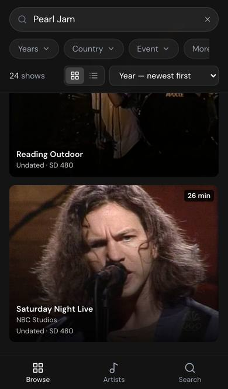 | 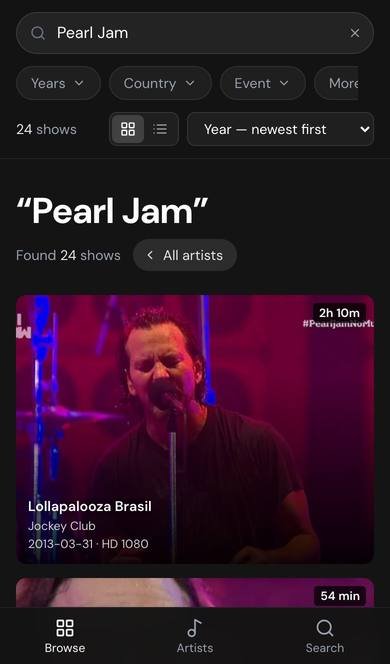 |
| R2 + R4 Two columns | 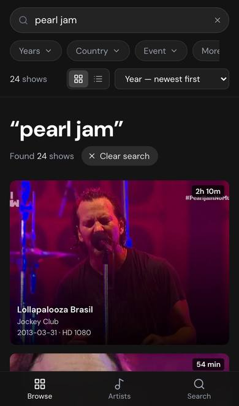 | 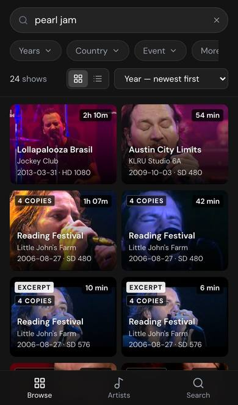 |
| R2 Three columns (rejected) | | 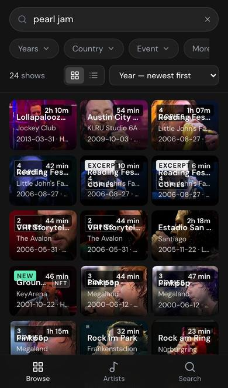 |
| R3 "ratm swu" | 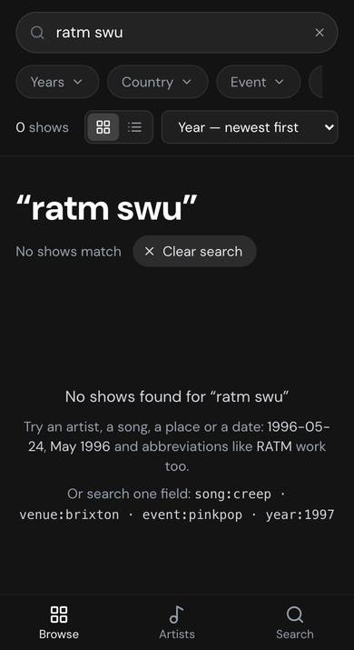 | 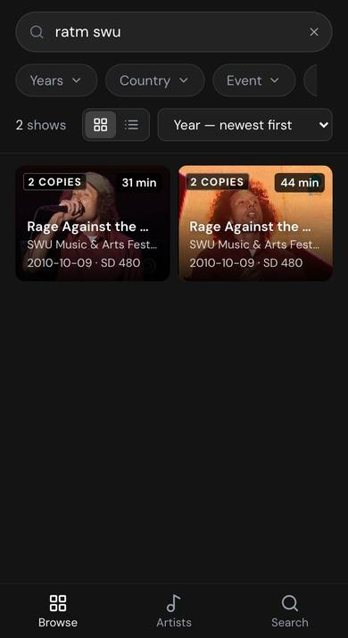 |
| R4 Keyboard up | 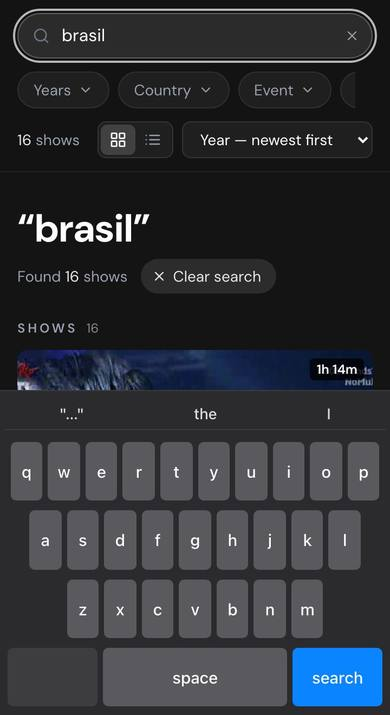 | 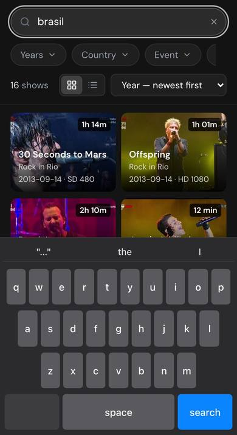 |
| R6 All artists | 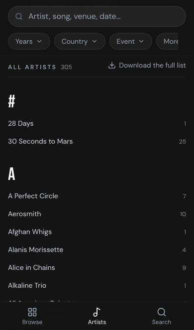 | 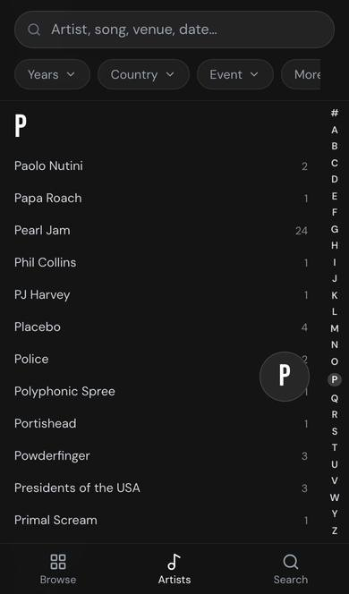 |
| R7 Four filters on | 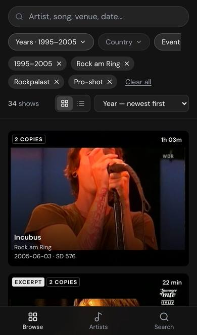 | 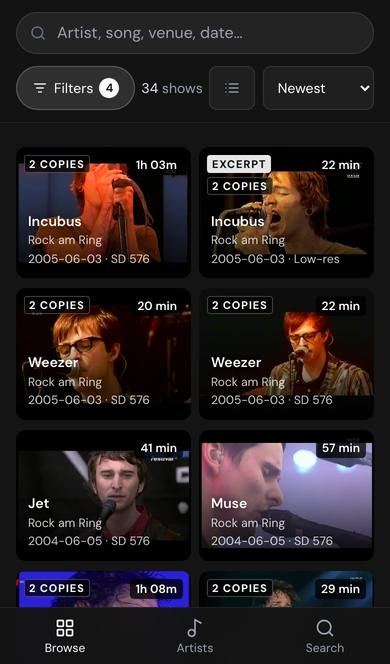 |
| R8 Filters | 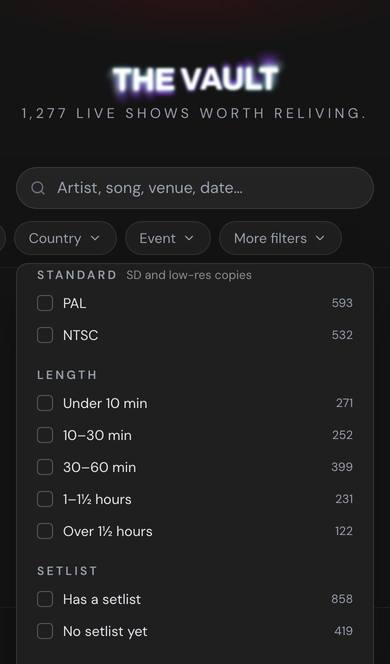 | 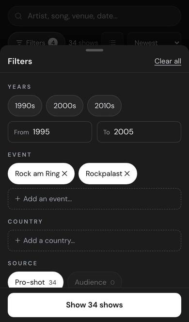 |
| R9 Copies | 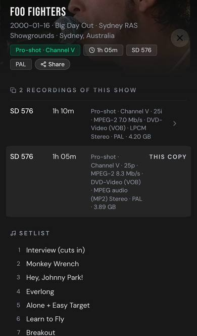 | 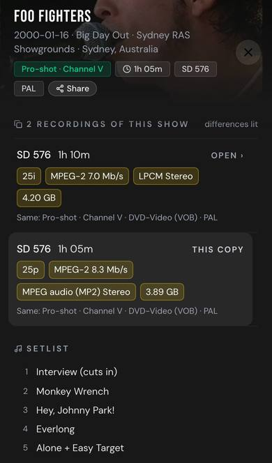 |
| R10 + R13 First screen | 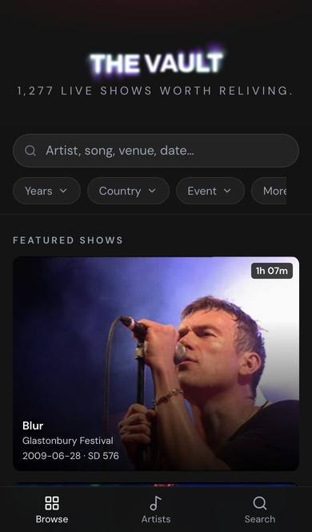 | 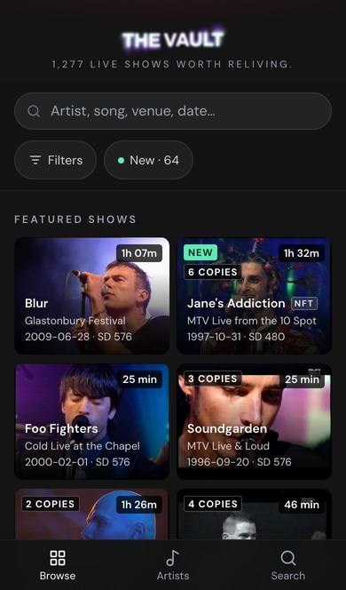 |
| R11 Docked header | 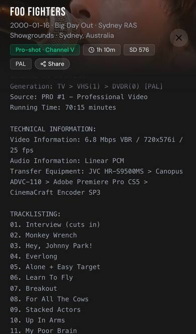 | 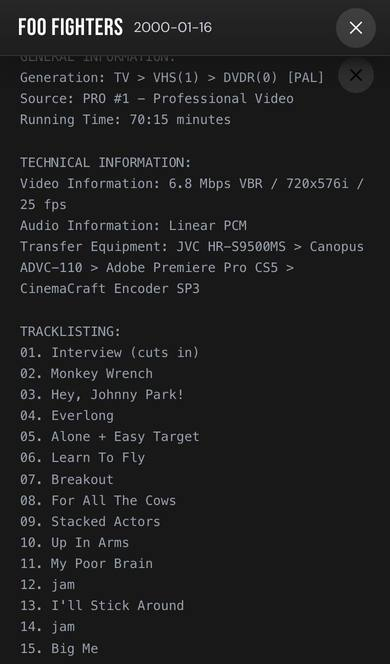 |
| R12 Targets under 44px | 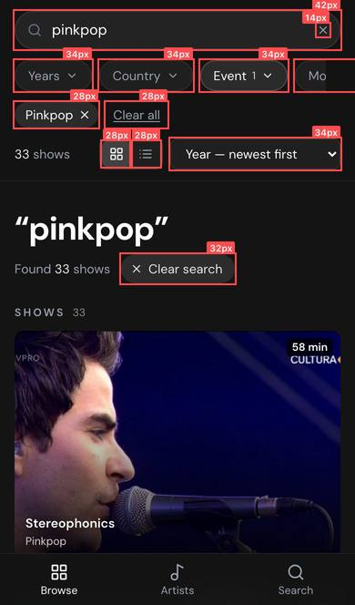 | |

## Built — branch `mobile-audit` (2026-11-08)

The owner picked B on all fourteen. Built on the branch `mobile-audit` for preview, not on `main`
until he merges it. Measured on the branch in the same emulation as the audit:

| # | What was built | Today → branch |
|---|---|---|
| R1 | An artist opens at the top (`jumpToY`); clearing a search and the Browse tab jump too | lands at y 6,477 of 7,141 → 0 |
| R2 | Two columns on every phone, 8px apart | Pearl Jam 10.8 screens → 2.9 (iPhone), 2.7 (Galaxy), 2.9 (125% text) |
| R3 | Initials beside other words, only when the words as typed find nothing | 0 of 10 trader queries → 10 of 10 |
| R4 | No query title, Found or Clear search on a phone; Search key closes the keyboard; the bar's row steps aside while typing | "brasil" with the keyboard up: 0 shows → 4 |
| R5 | A history entry per view (artist, A–Z jump, landing ↔ results, a new search after 2 s or Enter); Back restores the scroll position | Back left the site → steps back, to the pixel |
| R6 | All artists (and the Artists tab from that artist) return to the place; a letter index beside the list on phones | 13.5 screens of scrolling → none; 11,605 → 11,605 |
| R7 | Search, then one 44px row: Filters N · count · layout · sort | bar with four filters 235px → 121px; 1 card → 6 |
| R8 | Filters sheet: every filter as 44px chips with live counts, Show N shows | More filters 64–114px off-screen → all reachable |
| R9 | Copies stacked, differences as lit chips, "Same: …" | — |
| R10 | Masthead 18/12px padding, wordmark 48%, line 12px; none held sideways | first screen 1 show → 4 (iPhone), ½ → 2 + 2 halves (SE) |
| R11 | Docked header one line, name and date | 150px → 56px |
| R12 | 44px: close, viewer controls, dots, Technical details, A–Z rows, field ×, Share and Open full size (invisible area), every control in the bar and sheet | — |
| R13 | "● New · 64" beside Filters on the landing | "New" off-screen → one tap |
| R14 | A grid's first four stills eager, high priority | not re-measured on slow 4G |

**Where the build departs from the proposal:** the line under the wordmark is 12px, not 11px (the
site's floor, F13); New applies the New filter and leaves the sort alone (the sort is a lasting
preference, and Recently added would have carried over to the next artist); the bar's row folds
while scrolling only on results, as before (on the landing it moved the A–Z jump's target); and the
row stepping aside while typing is an addition (2 → 4 results above the keyboard).

**What changes on desktop** (md and up), on purpose, because it belongs on both: opening an artist
from the A–Z list, clearing a search, and Back and Forward (R1, R5, R6: the jump, the history
entries, the return to the place in the list); initials beside other words (R3); Enter counts as a
finished search for Back (the field keeps focus); the first four cards' stills load first (R14).
Nothing looks different: the artist page and filtered results are pixel-identical to the live site
at 1440×900, and the drawer's docked height, close button and copies rows measure the same.

## What works on a phone — keep it

- **Links:** they open the exact recording. × and Back close it at the same scroll position.
- **Share:** a one-line reference plus the show's own link.
- **The tab bar:** labelled, and Search raises the keyboard in one tap.
- **Search in traders' terms:** `24.05.96`, `16/01/00`, `brasil`, `multishow`, `channel v`.
- **The empty state:** names the filters and offers "Show N without the filters".
- **Honest partial dates:** "2001 (date unknown)".
- **125% text:** holds with no sideways scrolling.
- **The search field:** 16px, so iOS doesn't zoom on focus.
- **The list view:** 8 rows per screen.
- **First paint:** 1.9s on slow 4G.

## Limits — check on a real phone

1. Does iPhone Safari also land at the bottom after an A–Z tap (R1)?
2. Does the iPhone edge-swipe Back leave the site after a search (R5)?
3. How many results show above the real keyboard (R4)?
4. Can "New" be reached in More filters on the landing page (R8)?
5. Does pinch-zoom work on a still in the viewer? (Not tested.)
